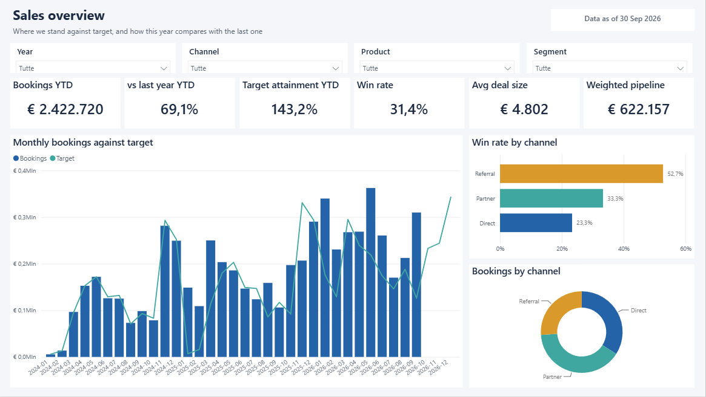
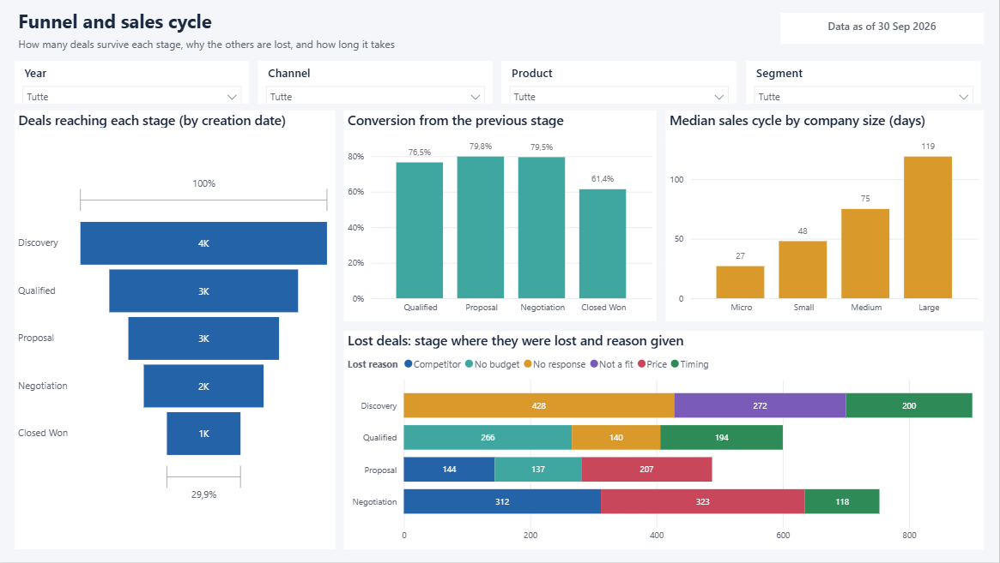
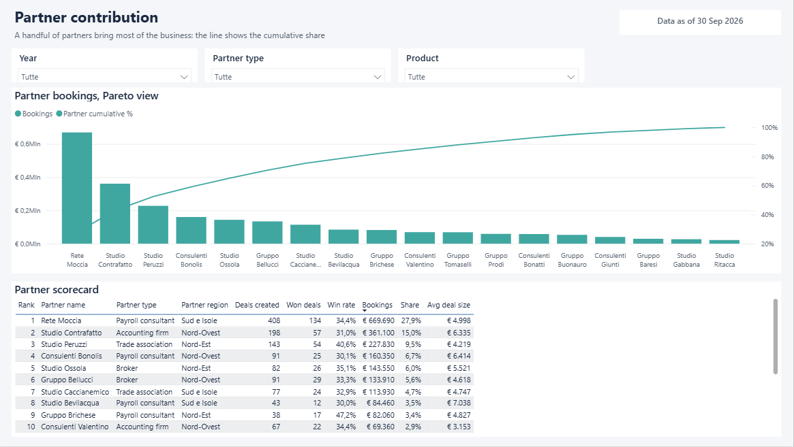
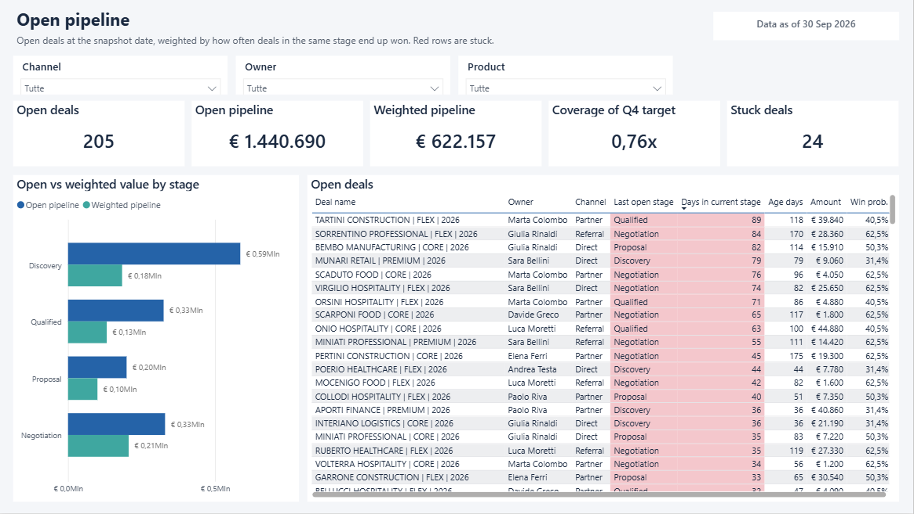
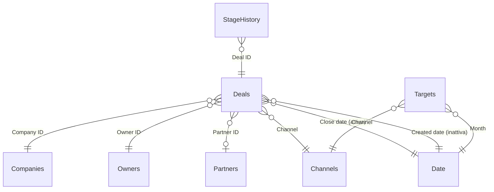

# Dashboard pipeline commerciale in Power BI

*[Read in English](README.md)*

Un report Power BI di quattro pagine per un team commerciale B2B: bookings rispetto al target, funnel e ciclo di vendita, contributo dei partner, pipeline aperta. È il tipo di dashboard che costruisco e aggiorno ogni settimana nel mio lavoro di operations data analyst, rifatto qui su dati sintetici per poterlo rendere pubblico.

La parte a cui tengo di più non si vede negli screenshot. L'intero progetto, modello semantico e report, viene generato da uno script Python come testo (formato PBIP: TMDL per il modello, PBIR per il report). Ogni misura, relazione e visual sta su git, e cambiare una misura diventa una revisione del codice come tutte le altre.



## Le pagine

| Pagina | La domanda a cui risponde |
|---|---|
| Sales overview | Siamo in linea con il target quest'anno, e come andiamo rispetto agli stessi mesi dell'anno scorso? |
| Funnel and sales cycle | In quale fase perdiamo i deal, per quale motivo, e quanto ci mette un deal a chiudersi in base alla dimensione del cliente? |
| Partner contribution | Quali partner portano davvero business? Quanto è concentrato? |
| Open pipeline | Cosa è ancora aperto, quanto vale davvero e quali deal sono fermi? |

<table>
<tr>
<td></td>
<td></td>
</tr>
<tr>
<td colspan="2"></td>
</tr>
</table>

## Il modello



Uno schema a stella classico, con due dettagli da spiegare. I deal sono collegati al calendario due volte: per data di chiusura (relazione attiva, per i bookings) e per data di creazione (inattiva, accesa con `USERELATIONSHIP` quando una misura conta le nuove opportunità). I target arrivano a livello di mese e canale, quindi si collegano alle dimensioni comuni Date e Channels e non direttamente ai deal.

## Alcune scelte che vale la pena spiegare

**Pipeline pesata sullo storico, non su una tabella fissa.** Quasi tutti i CRM pesano i deal aperti con percentuali fisse per fase (10% in Discovery, 60% in Negotiation e così via), inserite una volta da qualcuno e mai più verificate. Qui la probabilità viene calcolata dai dati: fra tutti i deal che hanno raggiunto una fase e poi si sono chiusi, quanti sono stati vinti. Un deal in Discovery pesa circa il 31%, uno in Negotiation circa il 62%. Se il processo commerciale cambia, i pesi lo seguono.

**Year to date a parità di periodo.** I dati si fermano al 30 settembre 2026. Confrontare il 2026 fin qui con tutto il 2025 farebbe sembrare quest'anno un disastro, quindi le misure YTD confrontano gennaio-settembre con gennaio-settembre. Le ho ancorate a una data di snapshot invece che a `TODAY()`, perché con un dataset fermo `TODAY()` renderebbe sbagliati tutti i numeri un po' alla volta.

**Deal fermi, definiti dai dati.** Un deal viene segnalato quando è nella fase attuale da più tempo del 90% dei deal che sono passati da quella fase prima di lui. Nessuna regola arbitraria tipo "più vecchio di 30 giorni": è normale che un cliente grande resti in Proposal più a lungo di uno piccolo, e la soglia si adatta a ogni fase.

**Mediana, non media, per il ciclo di vendita.** Pochi deal che si trascinano per un anno alzerebbero la media e finirebbero per non descrivere nessuno. La mediana dice com'è fatto un deal normale.

**Generato, non cliccato.** [build/generate_pbip.py](build/generate_pbip.py) scrive i file TMDL e PBIR. Il riferimento DAX in [docs/measures.md](docs/measures.md) nasce dalla stessa lista di misure, quindi la documentazione non può disallinearsi dal modello. Ogni misura ha anche la sua descrizione dentro il modello, che in Power BI compare come tooltip.

## Cose andate storte durante la costruzione

Le scrivo perché sono il tipo di cose che si imparano solo sbattendoci contro.

La prima versione aveva una misura chiamata `Deals`, come la tabella. Power BI non lo accetta e il messaggio di errore non aiuta a capirlo. Adesso si chiama `Deal count`.

Nella misura del Pareto avevo chiamato una variabile `current`. Per DAX è una parola riservata e l'intero visual falliva con un generico "errore in uno o più campi". Rinominata in `thisPartner`.

Il ranking dei partner dava 1 quasi a tutti. Nella tabella ci sono anche tipo di partner e regione su ogni riga, e quei filtri restavano attivi mentre `RANKX` scorreva i nomi dei partner: ogni partner veniva confrontato con una lista quasi vuota. Fare il ranking su `ALLNOBLANKROW ( Partners )` ha risolto.

I deal aperti sparivano dalla pipeline pesata appena si sceglieva un anno nello slicer. Non hanno una data di chiusura, quindi un filtro sulle date li elimina prima ancora che la misura venga calcolata. Adesso l'iteratore toglie esplicitamente il filtro sulle date.

## Come aprirlo

Serve Power BI Desktop (Windows, gratuito). Clona il repository, apri `SalesPipeline.pbip` e premi Aggiorna. La sorgente dati è un parametro chiamato `DataFolder` che di default punta ai CSV di questo repository su GitHub, quindi funziona senza nessuna configurazione.

Per rigenerare il progetto dal codice:

```bash
python build/prepare_data.py          # copia il dataset e costruisce i target mensili
python build/generate_pbip.py         # scrive modello semantico, report e docs/measures.md
python build/generate_pbip.py --local # uguale, ma legge i CSV dalla cartella locale data/
```

## Da dove arrivano i dati

Il dataset viene generato nel repository [sales-pipeline-analytics](https://github.com/messimarco0701/sales-pipeline-analytics), dove gli stessi numeri sono analizzati con SQL e Python. I target mensili vengono aggiunti qui da [build/prepare_data.py](build/prepare_data.py): il consuntivo dello stesso mese e canale dell'anno prima più un obiettivo di crescita, arrotondato come farebbe un ufficio amministrazione.

È tutto sintetico. I nomi di aziende, partner e commerciali sono inventati.

## Dai dati sintetici a quelli veri

In azienda la stessa struttura legge da un'estrazione del CRM invece che da CSV, è pubblicata sul servizio Power BI con aggiornamento pianificato e `DataFolder` punta a una cartella SharePoint. La data di snapshot diventa la data dell'ultima estrazione. Modello, misure e pagine restano gli stessi.

## Strumenti

Power BI (PBIP, TMDL, PBIR), DAX, Power Query M, Python.

## Progetti collegati

Questo repository fa parte di un piccolo portfolio costruito attorno allo stesso tipo di lavoro. La [pagina profilo](https://github.com/messimarco0701) spiega come si incastrano i pezzi.

| Progetto | |
|---|---|
| [crm-api-extractor](https://github.com/messimarco0701/crm-api-extractor) | Estrarre i dati dal CRM |
| [crm-billing-reconciliation](https://github.com/messimarco0701/crm-billing-reconciliation) | Controllarli con la fatturazione |
| [sales-pipeline-analytics](https://github.com/messimarco0701/sales-pipeline-analytics) | Analizzarli con SQL e Python |
| [powerbi-sales-dashboard](https://github.com/messimarco0701/powerbi-sales-dashboard) | Metterli davanti alle persone |
| [ai-contract-extraction](https://github.com/messimarco0701/ai-contract-extraction) | Portare i nuovi clienti nei sistemi |
