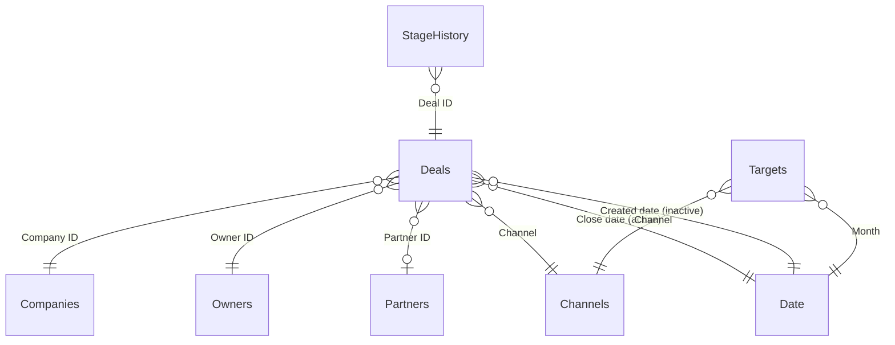

# Sales Pipeline Dashboard in Power BI

*[Leggi in italiano](README.it.md)*

A four page Power BI report for a B2B sales team: bookings against target, funnel and sales cycle, partner contribution, open pipeline. It's the kind of dashboard I build and maintain every week as an operations data analyst, rebuilt here on synthetic data so it can be public.

The part I care about most is not visible in the screenshots. The whole project, semantic model and report, is generated from a Python script as plain text (PBIP format: TMDL for the model, PBIR for the report). Every measure, relationship and visual lives in git, and changing a measure is a code review like any other.


## The pages

| Page | The question it answers |
|---|---|
| Sales overview | Are we on target this year, and how do we compare with the same months last year? |
| Funnel and sales cycle | At which stage do we lose deals, why, and how long does a deal take depending on the customer size? |
| Partner contribution | Which partners actually bring business? How concentrated is it? |
| Open pipeline | What is still open, what is it really worth, and which deals are stuck? |

<table>
<tr>
<td></td>
<td></td>
</tr>
<tr>
<td colspan="2"></td>
</tr>
</table>

## The model



A classic star schema. Two details are worth a word. Deals are linked to the calendar twice: by close date (active, for bookings) and by creation date (inactive, switched on with `USERELATIONSHIP` when a measure counts new opportunities). Targets come at month and channel level, so they connect to the shared Date and Channels dimensions instead of to Deals directly.

## A few choices worth explaining

**Weighted pipeline from history, not from a fixed table.** Most CRMs weight open deals with fixed percentages per stage (10% in Discovery, 60% in Negotiation and so on), typed in once by someone and never checked again. Here the probability is computed from the data: of all the deals that reached a stage and then closed, how many were won. A deal in Discovery is weighted at around 31%, one in Negotiation at around 62%. If the sales process changes, the weights follow.

**Year to date, like for like.** The data stops on 30 September 2026. Comparing 2026 so far with the whole of 2025 makes this year look terrible, so the YTD measures compare January to September with January to September. I anchored them to a snapshot date instead of `TODAY()`, because with a frozen dataset `TODAY()` slowly makes every number wrong.

**Stuck deals, defined by the data.** A deal is flagged when it has been sitting in its current stage longer than 90% of the deals that went through that stage before. No arbitrary "older than 30 days" rule: a large customer is expected to stay longer in Proposal than a small one, and the threshold adapts to each stage.

**Median, not average, for the sales cycle.** A handful of deals that drag on for a year would pull the average up and describe nobody. The median tells you what a normal deal looks like.

**Generated, not clicked.** [build/generate_pbip.py](build/generate_pbip.py) writes the TMDL and PBIR files. The DAX reference in [docs/measures.md](docs/measures.md) comes from the same list of measures, so the documentation can't drift away from the model. Every measure also carries its description inside the model, which shows up as a tooltip in Power BI.

## Things that went wrong while building it

I'm writing them down because they're the kind of thing you only learn by hitting them.

The first version had a measure called `Deals`, like the table. Power BI refuses that, and the error message doesn't make it obvious. Now it's `Deal count`.

In the Pareto measure I'd named a variable `current`. DAX treats it as a reserved word and the whole visual failed with a generic "error in one or more fields". Renamed to `thisPartner`.

The partner rank showed 1 for almost everyone. The scorecard table also has partner type and region on each row, and those filters stayed active while `RANKX` iterated over partner names, so each partner was ranked against an almost empty list. Ranking over `ALLNOBLANKROW ( Partners )` fixed it.

Open deals disappeared from the weighted pipeline as soon as you picked a year in the slicer. They have no close date, so a date filter removes them before the measure even runs. The iterator now removes the date filter explicitly.

## Open it

You need Power BI Desktop (Windows, free). Clone the repo and open `SalesPipeline.pbip`, then click Refresh. The data source is a parameter called `DataFolder`, which by default points to the CSV files in this repository on GitHub, so it works without any setup.

To rebuild the project from code:

```bash
python build/prepare_data.py          # copies the dataset and builds the monthly targets
python build/generate_pbip.py         # writes the semantic model, the report and docs/measures.md
python build/generate_pbip.py --local # same, but reads the CSVs from the local data/ folder
```

## Where the data comes from

The dataset is generated in my [sales-pipeline-analytics](https://github.com/messimarco0701/sales-pipeline-analytics) repository, where the same numbers are analysed with SQL and Python. Monthly targets are added here by [build/prepare_data.py](build/prepare_data.py): last year's actuals for the same month and channel plus a growth ambition, rounded like a finance team would.

Everything is synthetic. Company, partner and owner names are invented.

## Taking it to real data

At work the same structure reads from a CRM extraction instead of CSV files, it's published to the Power BI service with a scheduled refresh, and `DataFolder` points to a SharePoint folder. The snapshot date becomes the date of the last extraction. Model, measures and pages stay the same.

## Stack

Power BI (PBIP, TMDL, PBIR), DAX, Power Query M, Python.

## Related projects

This repository is part of a small portfolio built around the same kind of work. The [profile page](https://github.com/messimarco0701) explains how the pieces fit together.

| Project | |
|---|---|
| [crm-api-extractor](https://github.com/messimarco0701/crm-api-extractor) | Getting the data out of the CRM |
| [crm-billing-reconciliation](https://github.com/messimarco0701/crm-billing-reconciliation) | Checking it against billing |
| [sales-pipeline-analytics](https://github.com/messimarco0701/sales-pipeline-analytics) | Analysing it with SQL and Python |
| [powerbi-sales-dashboard](https://github.com/messimarco0701/powerbi-sales-dashboard) | Putting it in front of people |
| [ai-contract-extraction](https://github.com/messimarco0701/ai-contract-extraction) | Getting new customers into the systems |
